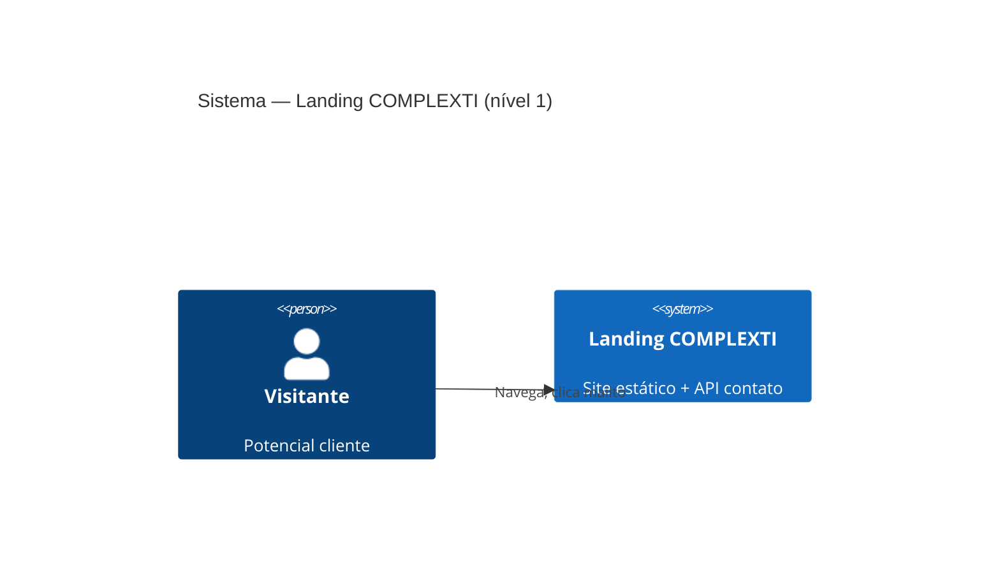
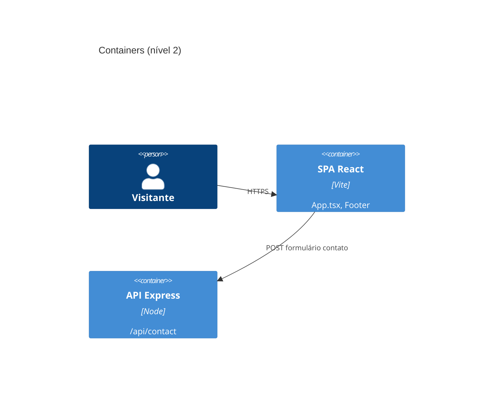

# Arquitetura — E-mail no rodapé (#2)

## Contexto

Landing page **React 19 + Vite + Tailwind 4**, servida por **Express** (`server.cjs`) com API de contato. Não há banco de dados nesta melhoria.

## Módulos envolvidos

| Módulo | Arquivo | Papel |
|--------|---------|-------|
| Rodapé | `src/App.tsx` (`Footer`) | Exibir link `mailto` usando constante `CONTACT_EMAIL` |
| Contato (referência) | `src/App.tsx` (`Contact`) | Padrão existente de `mailto` |

## Decisão

Evoluir o componente `Footer` inline em `App.tsx`: adicionar `<a href={mailto:...}>` reutilizando `CONTACT_EMAIL` já definido no topo do arquivo. **Sem** nova dependência, **sem** ADR dedicado (mudança de apresentação).

## Plano de implementação

| Passo | Responsável |
|-------|-------------|
| Incluir link de e-mail no `Footer` entre Política de Privacidade e copyright | dev-frontend |
| `npm run lint` e `npm run build` | dev-frontend |
| Verificação manual conforme `docs/qa/plano-testes.md` | qa-testes |